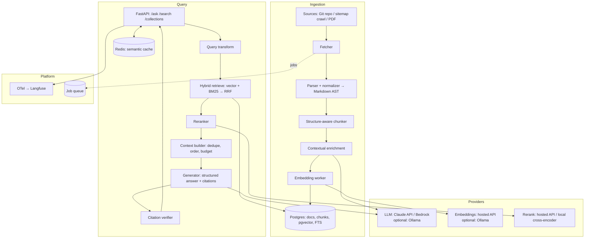

# `docs-copilot`

> Point it at any documentation site or Git repository. It crawls, indexes, and answers questions with citations to the exact source passage — and it can prove how good its answers are.

---

## 1. Why this project

Every team has documentation nobody reads, and most "chat with your docs" demos fall apart on real questions: stale indexes, wrong chunks retrieved, confident hallucinations, no way to tell whether a change made things better or worse.

This project builds the version that holds up: incremental indexing, hybrid retrieval with reranking, grounded answers with verifiable citations, and — the part most RAG repos skip — **an evaluation harness and a published ablation study** showing which design choices actually matter.

**What you learn:** embeddings, vector databases, chunking, hybrid search, reranking, query transformation, structured outputs, prompt caching, provider abstraction, RAG evaluation, LLM observability, cost engineering, exposing a service as an MCP server.

---

## 2. Goals and non-goals

### Goals
- Ingest from multiple source types (docs website, Git repo of Markdown/MDX/RST, PDFs) into one index.
- Keep the index fresh with **incremental** re-indexing (only changed content is re-embedded).
- Answer questions with **inline citations** that link to the exact source URL + section anchor.
- Refuse or say "not found in the docs" when retrieval doesn't support an answer.
- Multiple isolated **collections** (one per docs set), multi-tenant safe.
- Hosted model APIs by default (Claude for generation; a hosted embedding and rerank API), behind a provider interface so each can be swapped.
- A reproducible **evaluation harness** with a golden dataset and CI quality gate.
- Full **tracing** of every request (retrieval, rerank, generation) with token and cost data.
- `docker compose up` runs the whole stack locally; model calls go to hosted APIs using keys from `.env`.
- **Optional:** an offline profile using Ollama for generation and embeddings (for air-gapped demos or zero-cost dev), clearly marked as lower quality.

### Non-goals (v1)
- A polished end-user product UI (a minimal web UI and CLI are enough).
- Multi-modal retrieval (images/diagrams) — stretch goal.
- Real-time collaborative features, user accounts beyond API keys.
- Fine-tuning embedding or reranker models.

---

## 3. Users and use cases

| User | Need |
|------|------|
| Developer reading unfamiliar docs | "How do I configure X with Y?" with a link to the exact section |
| Docs maintainer | See which questions fail → find gaps in documentation |
| Platform team | Host one instance for many internal docs sets |
| Any MCP-capable agent or IDE assistant | Call `search_docs` / `ask_docs` as tools |

Example questions the system must handle:
- Factual lookup: "What is the default timeout for the HTTP client?"
- Procedural: "How do I set up authentication with OIDC?"
- Comparative: "What's the difference between mode A and mode B?"
- Multi-hop: "Which config option controls retries, and what does the error look like when they're exhausted?"
- Unanswerable: "Does it support feature Z?" (when it doesn't) → must say not found.
- Version-specific: "In v3, how do I …?"

---

## 4. Feature scope

### MVP (weeks 1–2)
- Ingest a Git repo of Markdown and a docs website (sitemap-driven crawl).
- Structure-aware chunking (by heading hierarchy).
- Dense retrieval (pgvector) + BM25 (Postgres full-text) fused with Reciprocal Rank Fusion.
- Reranking (hosted rerank API, or a local cross-encoder).
- Answer generation with Claude using structured output (answer + citations JSON).
- `/ask` and `/search` HTTP endpoints, CLI, minimal web UI with streaming.
- Golden dataset v1 (50 Qs) + eval runner + Langfuse tracing.

### v1 (week 3)
- Incremental re-indexing with content hashing and scheduled syncs.
- Query transformation (rewrite, multi-query, HyDE — measured, not assumed).
- Contextual chunk enrichment (prepend document/section context to each chunk before embedding).
- **Prompt caching** for the system prompt + retrieved context (Claude supports explicit cache breakpoints — measure the cost and latency savings).
- Semantic answer cache (Redis) with invalidation on re-index.
- Conversation mode (follow-up questions with query condensation).
- Golden dataset v2 (100+ Qs) + CI eval gate + ablation study in README.
- MCP server interface so any MCP client can use it.

### Stretch
- Version-aware retrieval (filter by docs version metadata).
- Code-aware chunking for API references (tree-sitter).
- Multi-modal: index diagrams via a vision model's descriptions.
- "Docs gap report": cluster unanswered questions to suggest missing docs.
- GraphRAG-style entity index for multi-hop questions (measure whether it helps).
- Ollama offline profile + a quality comparison table (hosted vs local).

---

## 5. Architecture



### Components

**Fetcher**
- Git: shallow clone, track commit SHA, diff against last indexed SHA for incremental updates.
- Web: sitemap.xml first, fallback to bounded BFS crawl; respect `robots.txt`, rate limit, `ETag`/`Last-Modified` for change detection.
- PDF: text extraction with layout awareness (headings, tables).

**Parser / normalizer**
- Convert everything to a normalized Markdown AST: headings, paragraphs, code blocks, tables, lists, links.
- Strip nav, footers, cookie banners (boilerplate removal for HTML).
- Preserve heading anchors for deep-link citations.

**Chunker** (the most important quality lever — make it pluggable)
- Strategies: `fixed` (baseline), `recursive`, `heading` (default), `semantic` (embedding-similarity breakpoints).
- Rules: never split code blocks or tables; keep heading path (`H1 > H2 > H3`) as metadata; target ~300–800 tokens with overlap; parent-child linking (small chunk retrieved, parent section available for context expansion).

**Contextual enrichment**
- For each chunk, generate (or template) a 1–2 sentence context: doc title, section path, what this section is about. Prepend before embedding and BM25 indexing. Measure the lift in the ablation.
- Use a fast/cheap model tier for this; batch requests (use the provider's batch API for bulk indexing — it's much cheaper), cache by chunk hash, and allow a template-only mode (no LLM).

**Embedding worker**
- Batches, retries with backoff, idempotent by `(chunk_hash, embedding_model)`.
- Store the embedding model name + dimension per row; never mix models in one index.

**Hybrid retriever**
- Vector: pgvector HNSW index, cosine distance, top-k (e.g. 30).
- Lexical: Postgres `tsvector` with BM25-like ranking (or ParadeDB/pg_search if you want true BM25 — ADR).
- Fusion: Reciprocal Rank Fusion (k=60) as default; weighted fusion as an option.
- Metadata filters: collection, version, doc type, path prefix.

**Reranker**
- Hosted rerank API or a local cross-encoder. Rerank top 30 → keep top 5–8.
- Must be switchable off for the ablation.

**Context builder**
- Deduplicate overlapping chunks, merge adjacent chunks from the same section, optionally expand to parent section.
- Order by document then position (or by score — measure).
- Enforce a token budget; report what was dropped.
- Place stable content (system prompt, instructions) first so it's cacheable; retrieved context after a cache breakpoint.

**Generator**
- System prompt: answer only from provided context, cite every claim, say "not found" otherwise.
- Structured output schema (below) via the provider's native structured-output / tool-schema mode.
- Streaming: stream the answer text; send citations as a final event.
- Model tiers configurable: fast tier for simple lookups, strong tier for multi-hop (stretch: route by query complexity and measure).

**Citation verifier**
- For each citation, check the cited chunk ID was actually in the context, and (cheap check) that key terms of the claim appear in the chunk. Optionally an LLM-judge check in eval mode only.
- Drop or flag unsupported citations; expose `grounded: true/false`.

**Semantic cache**
- Key: embedding of the condensed question + collection + index version. Similarity threshold configurable. Invalidated on re-index of that collection.

**Provider layer**
- Interfaces: `ChatModel`, `EmbeddingModel`, `Reranker`.
- Default implementations: Claude via the Anthropic API (or Amazon Bedrock — same models, AWS billing/IAM), a hosted embedding model, a hosted reranker.
- Optional implementations: Ollama (chat + embeddings), local cross-encoder.
- A price table per model so every call records `cost_usd`.

---

## 6. Data model (Postgres)

```sql
collections(id, name, description, source_type, source_config jsonb,
            embedding_model, embedding_dim, index_version, created_at)

documents(id, collection_id, uri, title, version_tag, content_hash,
          source_revision, last_fetched_at, status)

chunks(id, document_id, collection_id, ordinal, heading_path text[],
       anchor, content text, context_prefix text, token_count,
       chunk_hash, parent_chunk_id, metadata jsonb,
       embedding vector(N), tsv tsvector)

ingestion_runs(id, collection_id, started_at, finished_at, status,
               docs_added, docs_updated, docs_deleted, chunks_embedded,
               tokens_used, cost_usd, error)

query_log(id, collection_id, question, condensed_question, answer,
          grounded, latency_ms, tokens_in, tokens_out, cache_read_tokens,
          cost_usd, model, trace_id, feedback, created_at)
```

Indexes: HNSW on `chunks.embedding`, GIN on `chunks.tsv`, btree on `(collection_id, document_id)`, unique on `(collection_id, chunk_hash)`.

---

## 7. API

### HTTP

```
POST /v1/collections                 create collection (source config)
POST /v1/collections/{id}/sync       trigger (incremental) ingestion
GET  /v1/collections/{id}/runs       ingestion history
POST /v1/search                      retrieval only → ranked chunks
POST /v1/ask                         RAG answer (supports stream=true, SSE)
POST /v1/feedback                    thumbs up/down + comment on an answer
GET  /healthz /readyz /metrics
```

### `/v1/ask` response schema

```json
{
  "answer": "string (markdown, with [1], [2] markers)",
  "citations": [
    {"marker": 1, "chunk_id": "…", "title": "…", "url": "https://…#anchor",
     "heading_path": ["Guide", "Auth", "OIDC"], "quote": "short supporting span"}
  ],
  "grounded": true,
  "not_found": false,
  "usage": {"input_tokens": 0, "output_tokens": 0, "cache_read_tokens": 0,
            "cost_usd": 0.0, "cache_hit": false, "model": "…"},
  "trace_id": "…"
}
```

### MCP server
- Tools: `search_docs(collection, query, k)`, `ask_docs(collection, question)`, `list_collections()`.
- Resources: `docs://{collection}/{document_id}` for full document text.
- Transport: Streamable HTTP (and stdio for local use).
- Verify it from Claude Desktop / Claude Code and the MCP Inspector.

### CLI
```
docs-copilot add-collection --name fastapi --git https://github.com/... --path docs/
docs-copilot sync fastapi
docs-copilot ask fastapi "How do I add CORS?"
docs-copilot eval run --dataset evals/fastapi.jsonl --config configs/hybrid_rerank.yaml
```

---

## 8. Evaluation (the heart of the project)

### Golden dataset
- Pick 2–3 public docs sets of different shapes (e.g. a web framework, a database, a CLI tool).
- Per set: 50–100 questions across the categories in §3, including **≥15% unanswerable** questions.
- Each item: `question`, `reference_answer`, `relevant_doc_uris` (and ideally chunk-level spans), `category`, `difficulty`.
- Build it semi-automatically: an LLM drafts Q/A pairs from sampled sections → **you review every one by hand**. Hand-write the hard multi-hop and unanswerable ones. Version the dataset (`v1`, `v2`).

### Metrics

| Layer | Metric | How |
|-------|--------|-----|
| Retrieval | Recall@k, MRR, nDCG@k | Against labeled relevant docs/chunks |
| Generation | Faithfulness (claims supported by context) | LLM-as-judge with claim decomposition |
| Generation | Answer correctness vs reference | LLM-as-judge with a rubric (1–5) |
| Generation | Citation precision / recall | Verifier + judge |
| Behaviour | Refusal accuracy on unanswerable | Exact (not_found flag) |
| Ops | p50/p95 latency, tokens, cache hit tokens, $ per query | From traces |

### Judge calibration
- Hand-label 50 answers yourself. Report judge–human agreement (Cohen's kappa or simple % agreement). If it's low, fix the rubric before trusting any number. Put this in the README.
- Use a different (or stronger) model tier for judging than for generation to reduce self-preference bias; note the choice in an ADR.

### CI gate
- On every PR touching retrieval/prompt/chunking code: run the eval on a fixed **smoke subset** (~30 Qs) with response caching for unchanged calls.
- Fail if recall@5 or faithfulness drops more than a set threshold vs the `main` baseline.
- Full eval runs nightly / on release; results committed to `evals/results/` and charted.
- API keys for CI stored as GitHub Actions secrets; a hard spend cap per CI run.

### Ablation study (publish in README)
Grid over: chunking strategy × contextual enrichment on/off × retriever (vector / BM25 / hybrid) × reranker on/off × query transform (none / rewrite / multi-query / HyDE) × generation model tier. Report quality, latency and cost per configuration, and a short "what mattered" conclusion.

---

## 9. Observability

- OpenTelemetry spans per stage: `retrieve.vector`, `retrieve.lexical`, `retrieve.fuse`, `rerank`, `context.build`, `llm.generate`, `citations.verify`, with `gen_ai.*` attributes (model, input/output tokens, cache tokens, finish reason).
- Export to Langfuse (self-hosted via compose) — traces, prompt versions, scores (attach eval scores and user feedback to traces).
- Prometheus metrics: request rate, latency histograms per stage, cache hit ratio (semantic + prompt cache), ingestion lag, embedding queue depth, cost counters.
- Structured JSON logs with `trace_id`.
- Grafana dashboard JSON committed in the repo.

---

## 10. Security and safety

- **Indirect prompt injection:** crawled content is untrusted. Delimit retrieved context clearly, instruct the model to treat it as data, and add an eval set of poisoned documents ("ignore previous instructions…") — measure that answers don't follow them.
- **Crawler safety:** domain allowlist per collection, SSRF protection (block private IP ranges, metadata endpoints), size limits, timeouts.
- **Tenant isolation:** every query filtered by `collection_id` at the SQL level; tests that prove no cross-collection leakage.
- API keys per client, rate limiting per key.
- Provider API keys only in env/secrets manager; never logged; budget alerts on the provider console.
- PII: optional redaction pass at ingestion (data leaves your infra when sent to hosted APIs — document this).
- Write the threat model in `SECURITY.md`.

---

## 11. Performance and cost targets (tune after measuring)

- `/search` p95 < 300 ms (excluding reranker) on 100k chunks.
- `/ask` time-to-first-token p95 < 2 s.
- Incremental sync of a 1k-page docs set where 1% changed: < 2 min and only changed chunks embedded.
- Prompt caching reduces input cost on repeated/conversational queries — report the measured %.
- Track $/1k questions per configuration; publish it.

---

## 12. Tech stack (with alternatives to decide in ADRs)

| Concern | Default | Alternatives |
|---------|---------|--------------|
| API | FastAPI + SSE | — |
| Vector store | Postgres + pgvector | Qdrant, OpenSearch |
| Lexical | Postgres FTS | ParadeDB/pg_search (true BM25), OpenSearch |
| Orchestration | Thin own code + LangChain components where useful | LlamaIndex |
| Generation | Claude (Anthropic API or Bedrock), fast + strong tiers | Any provider via LiteLLM; Ollama (optional profile) |
| Embeddings | Hosted embedding API (e.g. via Bedrock or a dedicated embeddings provider) | Ollama / text-embeddings-inference (optional) |
| Reranker | Hosted rerank API | Local cross-encoder |
| Jobs | Simple Postgres-backed queue or Redis queue | Celery, Temporal (overkill for v1) |
| Cache | Redis | — |
| Tracing | OTel + Langfuse | Arize Phoenix |
| UI | Minimal (HTMX or small React) | — |

Keep the framework thin. A good learning outcome is understanding every step; use LangChain where it removes boilerplate (loaders, splitters), not as a black box.

---

## 13. Repository layout

```
docs-copilot/
├── src/docs_copilot/
│   ├── api/            # FastAPI routers, SSE, auth
│   ├── ingest/         # fetchers/, parsers/, chunkers/, enrich.py, embed.py
│   ├── retrieve/       # vector.py, lexical.py, fusion.py, rerank.py, query_transform.py
│   ├── generate/       # prompts/, context.py, generator.py, citations.py
│   ├── providers/      # interfaces + anthropic, bedrock, embeddings, rerank, ollama (optional)
│   ├── cache/
│   ├── mcp/            # MCP server
│   ├── storage/        # SQLAlchemy models, migrations (alembic)
│   ├── telemetry/
│   └── settings.py
├── evals/
│   ├── datasets/       # *.jsonl, versioned
│   ├── configs/        # ablation configs (yaml)
│   ├── judges/         # rubric prompts
│   ├── runner.py
│   └── results/
├── cli/
├── ui/
├── deploy/
│   ├── docker-compose.yml   # api, worker, postgres, redis, langfuse; `local` profile adds ollama
│   ├── helm/
│   └── terraform/           # optional AWS deploy
├── docs/adr/
├── tests/ (unit, integration, fixtures with recorded LLM responses)
├── .env.example
└── README.md
```

---

## 14. Testing strategy

- **Unit:** chunkers (golden inputs → expected chunks), fusion math, context budget logic, citation parsing.
- **Integration:** ingestion end-to-end against a fixture docs repo; retrieval against a seeded DB (testcontainers Postgres).
- **LLM calls:** record/replay fixtures so tests are deterministic and free; a small number of live "contract" tests behind a flag.
- **Contract:** response schema validation; MCP server tested with an MCP client.
- **Eval:** as in §8 — evals are tests for quality.
- **Load:** k6 or Locust against `/search` and `/ask`.

---

## 15. Milestones

| Week | Deliverable | Done when |
|------|-------------|-----------|
| 1 | Ingestion (Git + web) → chunks → pgvector; `/search` dense-only; compose stack | Can search a real docs set |
| 1 | Golden dataset v1 (50 Qs) + retrieval metrics runner | Baseline recall@5 recorded |
| 2 | Hybrid + RRF + reranker; `/ask` with structured citations + streaming; Langfuse tracing | Answer metrics recorded, traces visible |
| 2 | Judge calibration vs 50 hand labels | Agreement number in README |
| 3 | Incremental sync, contextual enrichment, query transforms, semantic cache, prompt caching | Sync test passes; ablation grid runs |
| 3 | CI eval gate, MCP server, injection test set, Helm chart | PR gate blocks a deliberate regression |
| 3 | README: architecture, ablation table, cost/latency numbers | Someone else can run it in 10 min with their own keys |

---

## 16. ADRs to write

1. Vector store choice (pgvector vs dedicated).
2. BM25 implementation (Postgres FTS vs pg_search vs OpenSearch).
3. Default chunking strategy (based on ablation results).
4. Fusion method (RRF vs weighted).
5. Framework usage boundary (what you take from LangChain vs write yourself).
6. Provider abstraction, default models per stage, and prompt-caching layout.
7. Citation format and grounding verification approach.
8. Cache invalidation strategy.
9. Evaluation methodology and judge model choice.

---

## 17. Engineering baseline

- README with measured numbers (quality, latency, cost) — no numbers, no claim.
- ADRs in `docs/adr/`.
- `docker compose up` for local; Helm/Terraform for cloud.
- CI: lint (ruff), types (mypy/pyright), unit + integration tests, eval gate, container build, SBOM + vulnerability scan.
- OpenTelemetry with GenAI semantic conventions.
- One typed settings object; `.env.example`; no secrets in the repo.
- `SECURITY.md`, `CONTRIBUTING.md`, license, issue templates.
- Python 3.12+, `uv`, Pydantic v2. Re-verify library versions when you start — this spec describes architecture, not versions.

---

## 18. Definition of done

- [ ] `docker compose up` + `docs-copilot add-collection` + `ask` works with hosted API keys from `.env`.
- [ ] Two+ public docs sets indexed; golden datasets committed.
- [ ] Ablation table with quality, latency, cost in README.
- [ ] Prompt-caching savings measured and reported.
- [ ] Judge calibration reported.
- [ ] CI eval gate active.
- [ ] Prompt-injection test set passes.
- [ ] MCP server works from a standard MCP client.
- [ ] Helm chart deploys to a cluster.
- [ ] ADRs written.
- [ ] (Optional) Ollama offline profile documented with its quality delta.

## 19. Concepts to study while building

Embedding models and similarity metrics; HNSW vs IVF indexes and their recall/latency tradeoffs; BM25; Reciprocal Rank Fusion; cross-encoders vs bi-encoders; lost-in-the-middle effects; contextual retrieval; HyDE; structured outputs / tool schemas; prompt caching mechanics; batch APIs; RAG evaluation metrics (faithfulness, answer relevance, context precision/recall); LLM-as-judge bias (position, verbosity, self-preference); OTel GenAI semantic conventions; MCP server basics.
